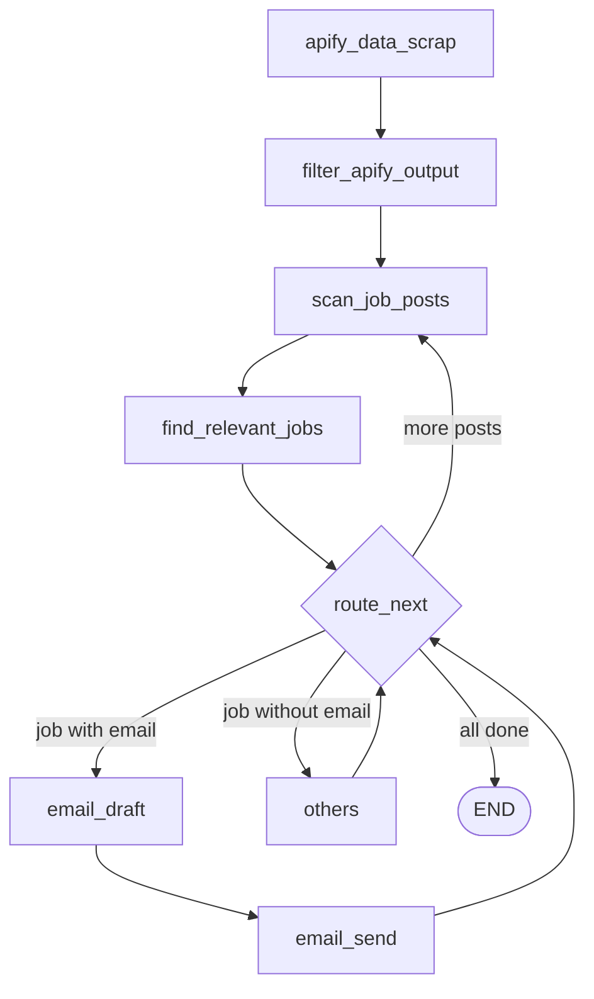

# Automated Job Emails Sender

An agentic workflow that finds fresh AI/ML hiring posts on LinkedIn, uses an LLM to turn each post into structured job data, filters the jobs with explicit rules, and emails the recruiter from your own Gmail account with your resume attached.

Built with **LangGraph**, **Gemini structured output (Pydantic)**, **Apify** and the **Gmail API**.

## What makes this more than a script

- **Stateful agent loop, not a linear chain.** A LangGraph state machine scans posts one at a time, handles every job inside a post, then moves on. One router function decides the next step from the state, so the loop has a single place to read and test.
- **LLM for extraction, code for decisions.** Gemini only turns messy post text into a typed `PostExtraction` schema. Relevance, location and experience rules run as plain Python afterwards, so every skipped job has a recorded reason and the decisions are repeatable.
- **Multiple jobs per post, with contacts matched to the right job.** The prompt and schema create one `JobListing` per job and tell the model to leave a contact empty instead of guessing.
- **Checkpoint-safe state.** Pydantic objects are stored as plain dicts (`model_dump()`) and rebuilt with `model_validate()` where needed, so the LangGraph checkpointer serializes cleanly. Per-run totals use `Annotated[list, add]` reducers.
- **Safe to run against real inboxes.** `DRY_RUN` mode prints emails instead of sending, addresses are normalized and de-duplicated, sent addresses persist across runs, and a failed send is logged without stopping the run.
- **Clean separation.** State, schemas, prompts, nodes, routing and graph wiring live in separate modules. Settings come from a typed `.env` config.

## How it works



| Node | What it does |
|---|---|
| `apify_data_scrap` | Runs the `harvestapi/linkedin-post-search` actor and returns raw posts |
| `filter_apify_output` | Keeps the useful fields and cleans links (strips `mailto:`, removes empties and duplicates) |
| `scan_job_posts` | Sends one post to Gemini and stores the structured result |
| `find_relevant_jobs` | Applies role, location and experience rules, and records a reason for each rejected job |
| `email_draft` | Fills the email template with the job and your details |
| `email_send` | Skips known addresses, sends or prints the email, and records the address |
| `others` | Placeholder for jobs with no email (apply link, WhatsApp) |

## Project structure

```
.
├── main.py                 # entry point
├── config.py               # typed settings loaded from .env
├── requirements.txt
├── .env.example
├── app/
│   ├── state.py            # LangGraph state (TypedDict + reducers)
│   ├── schemas.py          # Pydantic models for extraction
│   ├── llms.py             # Gemini client with structured output
│   ├── prompts.py          # extraction prompt and chain
│   ├── nodes.py            # all graph nodes
│   ├── routers.py          # route_next
│   ├── graph.py            # graph wiring
│   └── utils/
│       └── gmail_service.py  # OAuth, email template, candidate details
└── data/                   # git-ignored
    └── credentials/        # token.json, resume.pdf
```

## Setup

**Requirements:** Python 3.12+, an Apify account, a Gemini API key, and a Google Cloud project with the Gmail API enabled.

1. **Install**
   ```bash
   python -m venv .venv
   source .venv/bin/activate        # Windows: .venv\Scripts\activate
   pip install -r requirements.txt
   ```

2. **Google OAuth**
   - In Google Cloud Console, enable the **Gmail API**.
   - Create an OAuth client of type **Desktop app**.
   - On the consent screen, add your Gmail address as a **test user**.
   - Put the client ID and secret in `.env`.

3. **Configure**
   ```bash
   cp .env.example .env
   ```
   Fill in every value. Set `RESUME_PATH` and `TOKEN_FILE_PATH` to files under `data/credentials/`.

4. **Run (dry run first)**
   ```bash
   python main.py
   ```
   With `DRY_RUN=true` the emails are printed, nothing is sent. The first run opens a browser for Google sign-in and saves `token.json`.

5. **Go live.** Check the dry-run output, then set `DRY_RUN=false`.

## Configuration

| Variable | Purpose |
|---|---|
| `APIFY_API_TOKEN` | Apify access for the LinkedIn scraper |
| `GEMINI_API_KEY`, `GEMINI_DECISION_MODEL` | Gemini access and the model used for extraction |
| `GOOGLE_CLIENT_ID`, `GOOGLE_CLIENT_SECRET` | Gmail OAuth client |
| `TOKEN_FILE_PATH` | Where the OAuth token is saved |
| `NAME`, `PHONE`, `EMAIL`, `LINKEDIN` | Your details in the email signature |
| `RESUME_PATH` | Resume attached to every email |
| `DRY_RUN` | `true` prints emails, `false` sends them |
| `SENT_FILE` | JSON file of addresses already emailed |

## Customizing

- **Search query, post age and post count:** the Apify input in `apify_data_scrap` (`searchQueries`, `postedLimit`, `maxPosts`) and `maxposts` in `main.py`.
- **What counts as a relevant job:** the field descriptions in `app/schemas.py`, the rules in `app/prompts.py`, and the filters in `find_relevant_jobs`.
- **Email text:** `EMAIL_SUBJECT` and `EMAIL_FORMAT` in `app/utils/gmail_service.py`.
- **Run length:** each post takes about 2 to 4 graph steps, so raise `recursion_limit` in `main.py` as `maxposts` grows.

## Safety and responsible use

- Keep `DRY_RUN=true` until you have read the output.
- Never commit `.env`, `token.json`, `sent_emails.json` or your resume. `token.json` lets anyone send mail as you.
- Gmail limits how many messages an account can send per day, and bulk cold email can be marked as spam. Keep volumes small.
- Check LinkedIn's and Apify's terms before scraping, and only email contacts who posted their address for applications.

## Roadmap

- [ ] `others` node: handle apply links, WhatsApp numbers and DMs
- [ ] Tests for `route_next` and `find_relevant_jobs`
- [ ] An evaluation set to measure extraction accuracy
- [ ] Per-job tailoring of the email text
- [ ] Scheduled daily runs